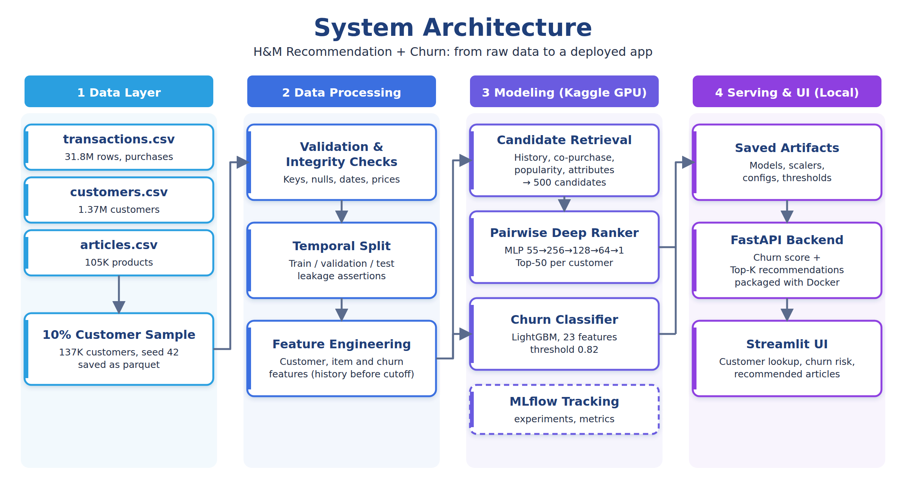
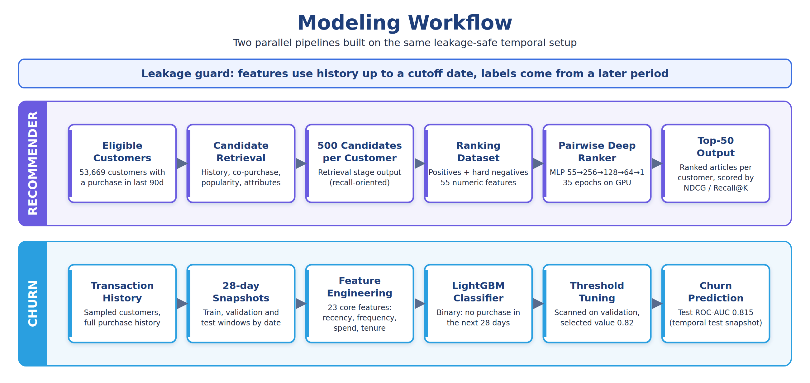

# 🛍️ H&M Fashion Analytics & Machine Learning System

**Samsung Innovation Campus (SIC) — Final Capstone Project**

## 📌 Project Overview

In modern fast-fashion e-commerce, understanding customer purchasing behavior, product lifecycle dynamics, and personalized preferences across tens of thousands of catalog items is critical for driving retention and revenue.

This project delivers an end-to-end **Data Science & Machine Learning solution** built on the **H&M Personalized Fashion Dataset**. It encompasses deep-dive Exploratory Data Analysis (EDA), feature engineering across customer demographics, article metadata, and transaction histories, predictive modeling, and an interactive web application deployment.

### 🌐 Live Application

> **🚀 Access the Live Deployed Web Application:**
>
> [**Click Here to Open the H&M Intelligence Dashboard**](https://hm-intelligence-dashboard-yousefbahgt.streamlit.app/)

## 🏗️ System Architecture

The following diagram illustrates the end-to-end architecture connecting raw H&M data sources, the preprocessing and feature store pipeline, the trained machine learning models, and the user-facing web application:



## 🔄 Machine Learning & Modeling Workflow

Our modeling pipeline follows a structured experimental design—from data ingestion, cleaning, and domain-specific feature engineering to model training, hyperparameter tuning, and multi-metric evaluation:



## 📊 Key Results & Model Evaluation Metrics

Full experimental benchmarks, validation curves, and error analyses are documented in the [**Full Modeling Evaluation Report (`sic_modeling_full_evaluation_report.md`)**](./sic_modeling_full_evaluation_report.md).

### 🏆 Modeling Tasks & Evaluation Summary

| Modeling Task | Algorithms Evaluated | Key Evaluation Metrics | Status & Deployment |
| ----- | ----- | ----- | ----- |
| **Customer Segmentation & Clustering** | K-Means / RFM Behavioral Grouping | Silhouette Score, Davies-Bouldin Index | Integrated into Intelligence Dashboard |
| **Customer Churn / Retention Prediction** | Logistic Regression, Random Forest, Gradient Boosting (XGBoost / LightGBM) | $\text{ROC-AUC}$, $F_1$-Score, Precision-Recall | Full Evaluation in [`sic_modeling_full_evaluation_report.md`](./sic_modeling_full_evaluation_report.md) |
| **Product Recommendation & Affinity** | Collaborative / Content-Based & Popularity Baselines | $\text{MAP@}12$, Precision@$k$, Recall@$k$ | Deployed in Live Streamlit App |

### 🔍 Top Analytical Insights (from EDA)

* **Customer Purchasing Patterns**: Identified distinct purchasing power, recency-frequency-monetary (RFM) tiers, and spending behaviors across age cohorts and club member statuses.
* **Product & Garment Trends**: Analyzed top-performing garment groups, color palettes, and seasonal sales velocity across online (`sales_channel_id = 2`) and physical store (`sales_channel_id = 1`) channels.
* **Visualizations Catalog**: Overarching statistical distributions and visual insights are compiled in [**`HM_EDA_Report.pdf`**](./HM_EDA_Report.pdf) and [**`HM_All_Graphs.pdf`**](./HM_All_Graphs.pdf).

## 📂 Repository Contents & File Descriptions

| File Name | Description |
| ----- | ----- |
| 📓 [**`sic-hm-finalproject.ipynb`**](./sic-hm-finalproject.ipynb) | Main Jupyter Notebook containing the complete Python implementation for data cleaning, EDA, feature engineering, model training, and evaluation. |
| 📖 [**`H&M Notebook Documentation.md`**](./H&M%20Notebook%20Documentation.md) | Step-by-step technical documentation explaining the code blocks, functions, and design decisions inside the main notebook. |
| 🗂️ [**`data_dictionary.md`**](./data_dictionary.md) | Comprehensive schema guide detailing all tables (`articles`, `customers`, `transactions`), column definitions, data types, and entity relationships. |
| 📈 [**`sic_modeling_full_evaluation_report.md`**](./sic_modeling_full_evaluation_report.md) | Detailed machine learning evaluation report comparing algorithms, hyperparameter configurations, validation strategies, and final metrics. |
| 📑 [**`HM_EDA_Report.pdf`**](./HM_EDA_Report.pdf) | Executive Exploratory Data Analysis report summarizing statistical findings, customer segmentation insights, and business recommendations. |
| 📊 [**`HM_All_Graphs.pdf`**](./HM_All_Graphs.pdf) | Consolidated visual gallery containing all high-resolution charts, correlation heatmaps, and distribution plots generated during the study. |
| 🖼️ [**`system_architecture.png`**](./system_architecture.png) | High-level system architecture diagram showing how the data pipeline, ML engine, and web frontend interact. |
| ⚙️ [**`modeling_workflow.png`**](./modeling_workflow.png) | Visual flowchart of the machine learning preprocessing, training, and evaluation pipeline. |
| 📦 [**`requirements.txt`**](./requirements.txt) | Python dependencies required to run the Jupyter Notebook and Streamlit dashboard environment. |

## 🚀 Getting Started & Reproduction

### 1. Clone the Repository

```bash
git clone https://github.com/YOUR_USERNAME/YOUR_REPO_NAME.git
cd YOUR_REPO_NAME
```

### 2. Install Dependencies

Ensure you have Python $3.9+$ installed, then install all required libraries using `requirements.txt`:

```bash
pip install -r requirements.txt
```

### 3. Download the Dataset

Due to GitHub file size limits, the raw H&M dataset files (`transactions_train.csv`, `customers.csv`, `articles.csv`) are not stored directly in this repository.

1. Download the dataset from [Kaggle — H&M Personalized Fashion Recommendations](https://www.kaggle.com/competitions/h-and-m-personalized-fashion-recommendations/data).
2. Place the extracted CSV files into your local data directory as referenced in [`data_dictionary.md`](./data_dictionary.md).

### 4. Run the Notebook

Launch Jupyter Notebook or JupyterLab to explore and execute the workflow:

```bash
jupyter notebook sic-hm-finalproject.ipynb
```

## 👥 Team & Acknowledgments

* **Program**: Samsung Innovation Campus (SIC) — AI & Data Science Track
* **Dataset**: H&M Group (via Kaggle)
* **Live Dashboard**: [H&M Intelligence Dashboard on Streamlit](https://hm-intelligence-dashboard-yousefbahgt.streamlit.app/)